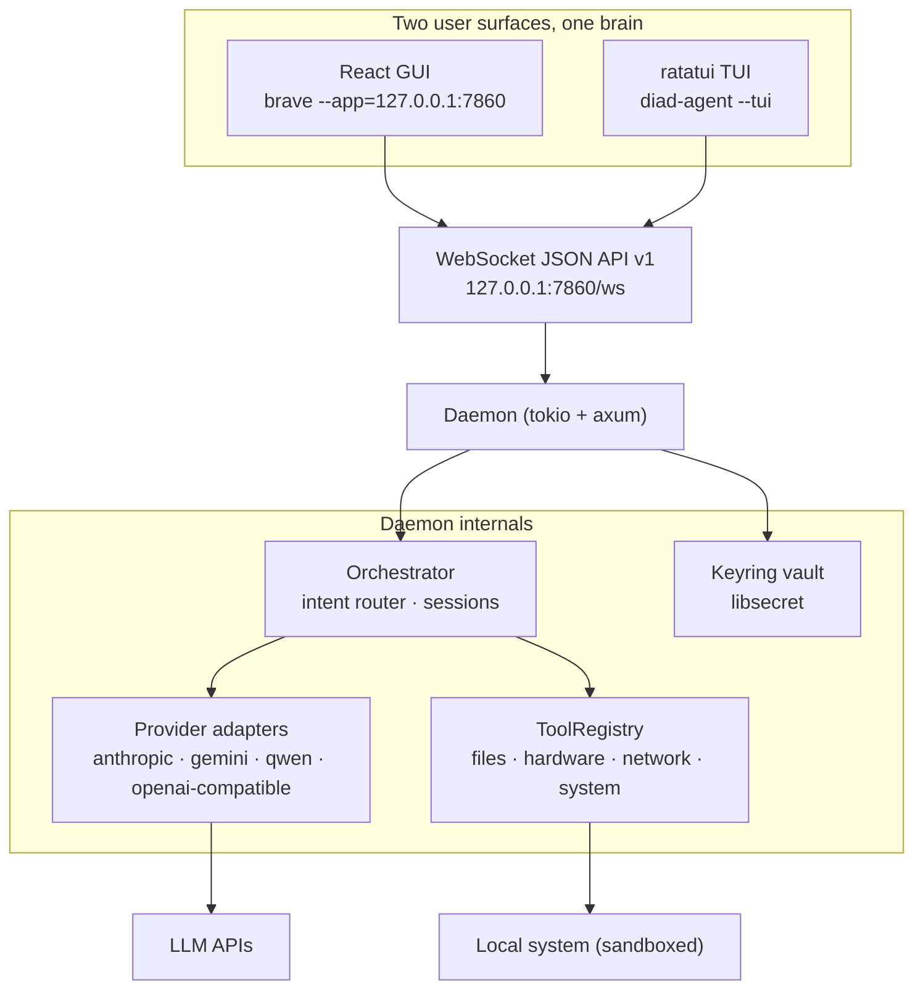

# DIAD — Intent-Driven Operating System

DIAD is a minimal, intent-driven operating system built on Arch Linux. It presents exactly two user surfaces:

1. **Brave Browser** — for web browsing and OAuth authentication flows
2. **DIAD AGENT** — the intent-driven IDE and agent interface, with **two faces sharing one brain**:
   - **GUI** (default) — a full IDE (chat, tool-call cards, AI-edit diff cards, code editor, terminal, agents hub) served by the local daemon at `http://127.0.0.1:7860`
   - **TUI** — the keyboard-first ratatui client (`diad-agent --tui`), a thin client over the same daemon's WebSocket API

The DIAD AGENT daemon replaces the terminal, file manager, system administration tools, and code editor. It connects to cloud LLM providers via authenticated APIs and translates user intent into system-level actions executed locally through sandboxed Rust functions.

> **Scope, honestly**: DIAD v1.0 is an **agent console**, not a general-purpose
> desktop OS. It provides a curated, sandboxed set of file/hardware/network/
> system actions plus a notification/clipboard/night-light/trash surface; it is
> not a full file manager or administration suite. See `docs/ROADMAP.md` for
> the v1.0/v1.1/v1.2 scope split.

Every major model family is selectable from a single interface (press `F6` or type
`/model` in the chat): Anthropic Claude, Google Gemini, OpenAI (incl. Codex
models), Alibaba Qwen, Moonshot Kimi, DeepSeek, Groq, Mistral, OpenRouter, and
local Ollama — plus any custom OpenAI-compatible endpoint you configure.

## Architecture



See `docs/ARCHITECTURE.md` for the boot chain, the full WebSocket protocol and
the sandbox model.

## Providers

DIAD speaks the OpenAI-compatible Chat Completions protocol for most providers (one shared code path), and native protocols for Anthropic, Gemini and Qwen. API keys are stored **per provider** in the system keyring (libsecret) and never logged or written to disk in plaintext.

| Provider     | Type                | Base URL                                | Model (default)           | Needs key? |
|--------------|---------------------|-----------------------------------------|---------------------------|------------|
| anthropic    | native (Messages)   | `https://api.anthropic.com/v1`          | `claude-sonnet-4-20250514`| Yes        |
| gemini       | native (Generate)   | `https://generativelanguage.googleapis.com` | `gemini-2.5-flash`     | Yes        |
| openai       | OpenAI-compatible   | `https://api.openai.com/v1`             | `gpt-5`                   | Yes        |
| qwen         | OpenAI-compatible   | `https://dashscope.aliyuncs.com/compatible-mode/v1` | `qwen-max`     | Yes        |
| kimi         | OpenAI-compatible   | `https://api.moonshot.ai/v1`            | `kimi-k2-0905`            | Yes        |
| deepseek     | OpenAI-compatible   | `https://api.deepseek.com`              | `deepseek-chat`           | Yes        |
| groq         | OpenAI-compatible   | `https://api.groq.com/openai/v1`        | `llama-3.3-70b-versatile` | Yes        |
| mistral      | OpenAI-compatible   | `https://api.mistral.ai/v1`             | `mistral-large-latest`    | Yes        |
| openrouter   | OpenAI-compatible   | `https://openrouter.ai/api/v1`          | `anthropic/claude-sonnet-4`| Yes        |
| ollama       | OpenAI-compatible   | `http://localhost:11434/v1`             | `qwen2.5:7b`              | **No** (local) |
| *custom*     | OpenAI-compatible   | *your base URL*                         | *your model*              | Usually    |

### Model picker

Press `F6` (or type `/model`) to open the provider picker. Every configured provider is listed with its connection status:

- `● configured` — a key is stored in the vault (or the provider needs none, e.g. Ollama)
- `○ no key` — selecting it triggers a masked **SecurePrompt**; the key is stored in the vault slot named after the provider and the provider is activated

Selecting a provider switches to it instantly and opens its **model list** (arrow keys, Enter to apply). The active model is shown in the top-bar pill as `PROVIDER · model`.

- OpenAI model list: `gpt-5`, `gpt-5-codex`, `codex-mini-latest`, `o4-mini`
- Anthropic: `claude-sonnet-4-20250514`, `claude-opus-4-20250514`, `claude-haiku-4-20250514`
- Gemini: `gemini-2.5-flash`, `gemini-2.5-pro`, `gemini-2.5-flash-lite`
- Qwen: `qwen-max`, `qwen-plus`, `qwen-turbo`

`/connect <name>` also works for any provider name (e.g. `/connect kimi`).

### Custom OpenAI-compatible providers

Add arbitrary endpoints in `/etc/diad/diad.conf` (or `~/.config/diad/config.toml`):

```toml
[providers.myprovider]
type = "openai_compat"
base_url = "https://api.example.com/v1"
model = "my-model"
# Optional: static Authorization header (skips the vault key for this provider)
# auth_header = "Bearer sk-..."
```

The provider becomes selectable in the picker as `myprovider`; its API key is stored in the vault slot `myprovider`.

## External agents

DIAD can delegate tasks to the local AI coding CLIs you already have installed, turning one TUI into a hub for every major coding agent:

| CLI      | Detected via | Non-interactive invocation |
|----------|--------------|----------------------------|
| Claude Code | `which claude` | `claude -p "<task>"` |
| OpenAI Codex | `which codex` | `codex exec "<task>"` |
| Aider    | `which aider` | `aider --message "<task>"` |
| OpenCode | `which opencode` | `opencode run "<task>"` |
| Gemini CLI | `which gemini` | `gemini -p "<task>"` |

Usage:

- Ask the DIAD Agent (or the cloud LLM, via the `delegate_to_agent` tool) to hand a task to an agent — e.g. *"ask claude to refactor this module"*.
- Spawning always requires an explicit **y/N confirmation** in the TUI.
- The CLI runs non-interactively and its stdout streams into the chat pane as `[agent:<name>]` lines.
- If the CLI is not installed, the tool returns a friendly message telling you so.

Install the CLIs with your package manager or `npm` (e.g. `npm install -g @anthropic-ai/claude-code @openai/codex aider opencode-ai`).

## Philosophy

> The OS should understand what you want, not just what you type.

DIAD eliminates the friction between thought and action. Instead of navigating directory trees, typing shell commands, or editing configuration files, you express your intent in natural language. The DIAD AGENT reasons about your request, selects appropriate tools, and executes them — all within a secure, sandboxed environment.

## First Boot

On the DIAD ISO, Sway launches `diad-supervisor.sh`, which:

1. Runs hardware/network/power/display setup scripts (first-boot wizard if needed)
2. Starts the DIAD daemon headless (`diad-agent --daemon`, log at `~/.diad/daemon.log`)
3. Waits for `http://127.0.0.1:7860/health` (up to ~20 s)
4. Opens the **DIAD AGENT GUI** as a Brave app window on workspace 1
5. Opens the plain Brave browser on workspace 2 (after first-run installs it)

The GUI onboarding wizard walks through connecting a provider (API key goes
straight into the OS keyring) and optionally joining Wi-Fi. From the TUI, use
`diad-agent --tui` (or `Ctrl+Shift+X` in the GUI).

## Tech Stack

| Component | Technology |
|-----------|-----------|
| **Language** | Rust (Edition 2021) |
| **Async Runtime** | tokio |
| **Daemon / API** | axum + tokio-tungstenite (loopback HTTP + WebSocket, `127.0.0.1:7860`) |
| **GUI** | Vite + React 18 + TypeScript + Tailwind + zustand + CodeMirror 6 + xterm.js |
| **GUI Embedding** | rust-embed (`frontend/dist` compiled into the binary) |
| **TUI Framework** | ratatui + crossterm |
| **HTTP Client** | reqwest (with streaming) |
| **Serialization** | serde + serde_json |
| **Configuration** | config crate |
| **Secrets Storage** | keyring (libsecret) |
| **Logging & Tracing** | tracing + tracing-subscriber |
| **CLI Argument Parsing** | clap |
| **Window Manager** | Sway (Wayland) |
| **Terminal Emulator** | foot |
| **Browser** | Brave |
| **Base OS** | Arch Linux (minimal) |

## Quick Start

### Prerequisites

- Arch Linux (bare metal or VM)
- Internet connection
- API keys for at least one LLM provider

### Installation

```bash
# Clone the repository
git clone https://github.com/diad-project/diad.git
cd diad

# Run the installer (requires root for packages)
sudo ./install.sh

# Build the DIAD AGENT (release, GUI embedded)
make build-release

# Launch (or reboot into the Sway session)
diad-agent          # starts the daemon and opens the GUI
diad-agent --tui    # keyboard-first TUI client instead
```

### Keybindings (GUI)

| Keys | Action |
|------|--------|
| `Ctrl+K` | Command palette |
| `Ctrl+B` | Toggle activity bar |
| `` Ctrl+` `` | Terminal panel |
| `Ctrl+S` | Save file in editor |
| `F6` | Provider picker |
| `Ctrl+Shift+X` | Spawn the TUI client |
| `F9` | Back to the GUI |

### Building the GUI

```bash
# Build frontend/dist (embedded into the daemon binary via rust-embed)
make gui

# Then rebuild the release binary so it contains the new GUI
make build-release
```

### Building the ISO

```bash
# Build the bootable ISO (runs `make gui` first, then embeds the GUI
# into the release binary and assembles the image)
make iso

# Flash the resulting image (example)
sudo dd if=out/diados-*.iso of=/dev/sdX bs=4M status=progress
```

### Configuration

The DIAD Agent reads configuration from:
1. `/etc/diad/diad.conf` (system-wide)
2. `~/.config/diad/config.toml` (user-specific, takes precedence)

API keys are stored securely via `libsecret`/`gnome-keyring` and configured through OAuth or manual entry.

## Project Structure

```
diados/
├── agent/          # DIAD AGENT (Rust crate `diad-agent`)
│   ├── src/
│   │   ├── core/          # daemon, WS protocol, REST, PTY, server, notes
│   │   ├── tools/         # sandboxed capability surface
│   │   │   ├── files/     #   universal + filesystem tools
│   │   │   ├── hardware/  #   device, display, input, universal
│   │   │   ├── network/   #   connectivity + external AI CLIs
│   │   │   ├── system/    #   exec, help, os, power, process, security, update
│   │   │   └── registry.rs
│   │   ├── orchestrator/  # intent router, sessions, agent loop
│   │   ├── providers/     # LLM adapters (native + openai-compatible)
│   │   ├── auth/          # keyring vault + OAuth
│   │   ├── config/        # layered TOML configuration
│   │   └── tui/           # ratatui client (thin WS consumer)
│   └── tests/             # domain-split integration tests (29)
├── frontend/       # GUI (Vite + React + TS + Tailwind + zustand)
│   ├── src/
│   │   ├── components/    # shared primitives (TopBar, ToolCallCard, …)
│   │   ├── panels/        # ChatPanel, EditorPanel, TerminalPanel, …
│   │   ├── services/      # WebSocket + REST clients
│   │   ├── hooks/         # useWebSocket, useGlobalKeys
│   │   ├── stores/        # zustand store
│   │   └── lib/           # types + formatting
│   └── dist/              # built assets (embedded via rust-embed)
├── os/             # archiso profile (sway, systemd units, setup scripts)
├── docs/           # ARCHITECTURE, SECURITY, TESTING, ROADMAP, GETTING_STARTED, audits
├── Makefile        # build targets (build, gui, iso, test, lint, …)
└── install.sh      # system installer
```

## License

MIT — See LICENSE file for details.
